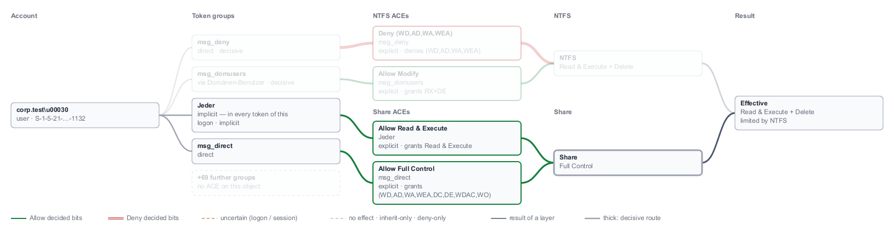

# Stars — User Guide

**Version:** v1.16.1 (see [CHANGELOG](../CHANGELOG.md))
**Audience:** Windows / AD administrators who want to audit NTFS and
SMB permissions **without changing anything**.

> **Read-only principle:** Stars never writes to NTFS, SMB shares, or
> Active Directory. It is a pure analysis, display, and export tool.
> Producing the actual fix for any issue surfaced by Stars remains
> your responsibility.

---

## Contents

1. [What can Stars do?](#what-can-stars-do)
2. [Installation and prerequisites](#installation-and-prerequisites)
3. [First run — the GUI](#first-run--the-gui)
4. [The eight GUI tabs](#the-five-gui-tabs)
5. [Identity input forms](#identity-input-forms)
6. [Active Directory binding (optional)](#active-directory-binding-optional)
7. [Local paths vs. SMB shares](#local-paths-vs-smb-shares)
8. [Rights labels — what F, RX, RW mean](#rights-labels--what-f-rx-rw-mean)
9. [Reading findings — diagnostic markers](#reading-findings--diagnostic-markers)
10. [Exporting — CSV, JSON, HTML](#exporting--csv-json-html)
11. [The CLI](#the-cli)
12. [Where is data stored?](#where-is-data-stored)
13. [Updates](#updates)
14. [FAQ](#faq)
15. [Further reading](#further-reading)

---

## What can Stars do?

Stars answers two core audit questions for any given NTFS path or SMB
share:

1. **"What can this user effectively do here?"** — per path one
   explainable finding (Read / Write / Modify / Full Control) plus a
   traceable permission path.
2. **"Who can access this path at all?"** — per path a trustee list
   (users / groups), separated by NTFS and Share DACL.

To answer them, Stars reads:

- **Active Directory** (via LDAP bind): identities, recursive group
  memberships (incl. cross-domain trust detection), primary groups,
  `userAccountControl` (account disabled).
- **Local server groups** on the share's target server
  (`BUILTIN\Administrators`, locally defined groups).
- **NTFS DACL** of every path — allow / deny ACEs, explicit and
  inherited entries, inheritance flags, owner.
- **SMB share DACL** and combines it restrictively with the NTFS mask
  (Share ∩ NTFS), listing each share ACE and the side that limits the
  result.
- **User Account Control and anonymous policies** of the target, read-only
  (`LocalAccountTokenFilterPolicy`, `FilterAdministratorToken`,
  `EveryoneIncludesAnonymous`) — so a local administrator over SMB gets an
  exact answer instead of a range.
- **Reparse points / junctions / symlinks** — followed; a real cycle
  (a junction back into its own parent chain) and a duplicate target
  (two junctions to the same directory) are told apart and each surfaced
  as its own typed diagnostic, never a silent skip or a double count.
- **Long paths** (`\\?\…`, UNC long-path form `\\?\UNC\…`).

For each finding Stars builds **structured diagnostic markers** when
assumptions are uncertain — the report never shows just a right, but
also what Stars knew and *did not know* while computing it.

### What Stars deliberately does **not** do

- Modify permissions (neither NTFS, nor share, nor AD).
- Modify AD accounts or group memberships.
- Create, move, or delete files or folders.
- ACL repair, permission cleanup, remediation workflows.
- Automatically apply recommendations.
- Open file contents (not even to scan for passwords; files with
  suspicious names are only **flagged**, never read).

The full list lives in
[features-and-limitations.md](features-and-limitations.md).

---

## Installation and prerequisites

### Prerequisites

- **Windows 10 / 11** or **Windows Server 2019 / 2022 / 2025**.
- For full functionality: **domain membership** or at least an AD
  read account.
- At least **read-DACL permission** on the analyzed paths (or
  `SeBackupPrivilege`).
- Recommended: run Stars as an account with read privileges, **not**
  as Administrator.

### Download

Get the installer from the GitHub release page:
[releases](https://github.com/Birgerson/stars-ad-permission-analyzer/releases).
Always take the newest **`Stars-vX.Y.Z-Setup.exe`** at the top of the list
(the current release is `v1.16.1`), and — recommended — the matching
`.sha256` file to verify integrity.

### Installation

1. Double-click the installer.
2. Default install path: `C:\Program Files\Stars\`.
3. A "Stars" start menu entry is created.
4. **No** drivers, **no** services, **no** auto-start components —
   Stars only runs while you have it open.

### First start

On first start Stars creates the scan history at
`%APPDATA%\Stars\stars_data.db` (SQLite file, only you have read
access).

---

## First run — the GUI

After starting Stars the main window shows **eight tabs:** `Analyze`,
`Graph`, `Groups`, `Scan Tree`, `Delta`, `Trusts`, `Shares`, `Info`. **Recommended first workflow:**

1. Open the **`Analyze`** tab — type an identity (user/group + SID)
   and a path. Hit "Analyze".
2. Read the result: effective right, full explanation chain,
   diagnostic markers. The **`Graph`** tab shows the same result as a
   diagram.
3. Optional: "Who has access?" for the path-centric trustee table.

If you only want to see what Stars can do at all, start with any local
folder and your own user SID — that works without LDAP configuration
and shows the engine in action.

> **Important on terminology:** "Identity", "Trustees", and "Risk
> findings" are **not separate tabs**. They are sections inside the
> real tabs (`Analyze`, `Groups`, `Scan Tree`, `Delta`, `Info`).

---

<a name="the-five-gui-tabs"></a>

## The eight GUI tabs

### `Analyze` tab — single-path analysis

**Purpose:** You have a specific path and want to know what a given
user can effectively do there.

**Fields (sections inside the tab):**

- **Target** — path, local (`C:\data\…`) or UNC (`\\server\share\…`).
- **Identity resolution** — the **Mode** field (Off, LDAPS, Plain LDAP,
  Global Catalog, Signed LDAP) and, for every mode but Off, the LDAP
  connection fields, and optionally a connection to a DC of a trusted
  domain ([Accounts of a trusted domain](#accounts-of-a-trusted-domain)).
  Which mode fits your situation:
  [Which mode to choose](#which-mode-to-choose). Identity input:
  [Identity input forms](#identity-input-forms).
- **SMB share (optional)** — SMB server and share name. Auto-detected
  for UNC paths; on local paths on a share, set manually if you also
  want the share mask evaluated.
- **Analyze** — runs the identity-bound evaluation.
- **Who has access?** — runs the **path-centric trustee table**
  instead: all trustees with their ACEs, NTFS and share separated.
  A share-DACL read failure appears as a typed diagnostic entry
  (`entry_kind: "diagnostic"`), never silently dropped. Since the
  exporter review 2026-07-26 the NTFS side is just as honest: an
  unreadable NTFS ACL says "who has access is UNKNOWN", partially
  unevaluated ACEs say "this list is incomplete", and an empty DACL
  says "no access for anyone" — a path never silently vanishes from
  this view anymore.

**Result of "Analyze":**

- effective right (Read / Write / Modify / Full Control),
- NTFS and share rights separately,
- explainable permission path
  (`User → Group → … → ACE → normalized right`). Each membership step
  shows one shortest chain — the same one on every run — and names every
  further group through which the user also reaches that group
  ("also a member through …"). If such a note is present, removing the
  user from the shown chain alone does **not** remove the membership,
- **all diagnostic markers of this result**, listed under
  *Diagnostics* with the same wording the CLI and the reports use —
  informational ones with `ℹ`, warnings with `⚠` in the attention
  colour. Since the gui review 2026-07-26 this block exists; before
  that the Analyze tab silently dropped every marker, so an
  understated right (unevaluated `sIDHistory`) or a flat SAM-fallback
  group resolution looked like a clean, complete answer.

### `Graph` tab — the result as a diagram


**Purpose:** See at a glance how the last `Analyze` result comes about:
which group brings which ACE, which ACE decided which bits, which layer
limits the result — and whether the logon itself is refused.

The graph is drawn from the result itself — the same decisions as the
numbered permission path, nothing computed anew. Read it left to right:

| Column | What it shows |
| --- | --- |
| Account | the analyzed user or group, its kind and SID |
| Token groups | only the groups an ACE on this object names, with their route (`direct`, `via A → B`, `implicit`) and state (`deny-only`, `uncertain`, `decisive`); "the account itself" when an ACE names the account directly; "+N further groups" for all the others |
| ACEs | two bands: **NTFS ACEs** on top, **Share ACEs** below (only when a share was evaluated) — each ACE that reaches the account, with what it did: "grants …", "denies …", "inherit-only", "not applied (deny-only)" |
| NTFS / Share | the result of each layer, in its band |
| Logon | only for an account of a trusted domain whose trust uses Selective Authentication: whether the account may log on to the server at all ([Selective Authentication](#selective-authentication--may-the-account-log-on-at-all)) |
| Result | the effective right and which side decides it: "limited by the share", "limited by NTFS", "NTFS and share agree", "no SMB share — NTFS decides" |

**Lines and colours** (the legend under the graph repeats them):

- **green** — an Allow decided bits (on its layer: a green share ACE
  decided share bits even when NTFS grants nothing),
- **red double line** — a Deny decided bits,
- **amber dashed** — uncertain: the group is in the token only for certain
  logons or session states (for example an elevated session),
- **grey dashed** — no effect, inherit-only (not on this object), or not
  applied because the group is deny-only,
- **slate** — the result of a layer flowing into the effective right,
- **thick** — the decisive route: the groups and ACEs that decided bits,
  and the layer that limits the result.

Every line connects neighbouring columns, so a line never passes through
a box it does not connect. An ACE band with "no ACE reaches the account"
means that no ACE of that layer names the account or one of its groups —
the permission path in the `Analyze` tab says why (for example an ACE
only for interactive logons).

**What the result box can add:**

- **"No access — logon refused before any ACE"** — the logon box is red:
  the server refuses the logon, so no permission is ever evaluated.
- **"logon not determinable"** — the logon box is amber and names the
  reason; the effective right lies between No access and the value shown.
- **"no SYNCHRONIZE: Explorer and most programs get "access denied""** —
  the rights are exact, but Explorer and most Windows programs cannot open
  the object
  ([SYNCHRONIZE](#access-denied-in-explorer-although-stars-shows-rights--synchronize)).

**Texts.** A box never hides a right: when the long form ("Read & Execute
+ Delete") does not fit, the box shows the `icacls` short form (`RX+DE`,
`(WD,AD,WA,WEA,S)`), over two or more lines if needed. A long name loses
its domain first (`…\name`), then its middle; a SID keeps its RID
(`S-1-5-21-…-1132`). The full text of every box is in its tooltip (HTML
report) and in the click detail (GUI).

**Working with the graph:**

- **Click a box** — its full text appears below the graph, and every route
  through it stays bright: the box, everything it is reached from and
  everything it leads to; the rest fades. Click it again to show
  everything. Clicking the *Share* box, for example, shows which groups
  and share ACEs make the share result:

  

- **Zoom** — `−` and `+`, **Actual size**, and **Fit width**, which fits
  the whole graph into the window width.
- **Save graph (SVG)** — type a file name ending in `.svg` in an existing
  folder and click the button. Stars writes the graph as shown ("Show all
  groups" included), in the light palette, with a caption line that names
  account and path, without the click selection. An existing file is never
  overwritten: pick a new name or delete the old file first. Every current
  web browser opens the file.
- The graph follows the **light/dark** switch.

**Further groups.** Only groups an ACE on this object names get a box of
their own; the account's other memberships do not change this result and
are one box, "+N further groups". They are not hidden:

- the line **under the graph** names them all;
- in the HTML report the box's **tooltip** names them (the first 40, then
  "… and N more");
- **"Show all groups"** (checkbox above the graph) draws each of them as
  its own grey dashed box with its route ("direct", "via A → B") and "no
  ACE here". The columns are then aligned at the top, so the account, the
  ACEs and the result stay in view next to the long group column.

**In the HTML report** every row has a collapsed "permission graph" — the
same diagram in the dark palette of the report. It scales with the window
down to 80 % of its size and scrolls below that; its tooltips carry the
full texts.

**Limits:** the graph shows the last `Analyze` result only — not scan
rows and not results loaded from the scan history. The numbered
permission path stays the complete explanation. Text widths are estimated
for the Windows standard font; with a much wider font a line can touch
the edge of its box.

### `Groups` tab — which groups is a user in?

**Purpose:** A pure identity question — *"which groups is this user (or
group) a member of?"* — with **no** path, ACL, or rights computation.
Previously you had to analyse some path just to read the resolved-groups
panel; this tab answers the question directly.

**Direction:** a toggle at the top switches between:

- **Member of** (default, upward) — the groups the identity is in
  (described below);
- **Members** (downward) — *who is in this group?* See
  [Members of a group](#members-of-a-group-reverse-direction) below.

**Fields:**

- **Identity** — one field for any form (local name, `DOMAIN\user`, UPN,
  or a raw SID), resolved automatically when you click **Show groups**.
  As you type, the same **live suggestion list** as the Analyze tab
  appears (local users, groups, well-known identities with `[U]`/`[G]`/
  `[L]`/`[W]` markers), so similarly named accounts are easy to tell
  apart.
- **Identity resolution → Mode** — the same five modes and connection
  fields as in `Analyze`; see [Which mode to choose](#which-mode-to-choose)
  and [LDAP configuration](#ldap-configuration) for the fields. In short:
  - **Off** (SAM/LSA) asks the Windows machine Stars runs on. On a domain
    controller that works, but it returns only the **direct** groups — a
    warning line ("No AD/LDAP connection — only direct (SAM/LSA) groups
    resolved") and a diagnostic say so, nested groups are missing. On a
    machine **outside** the domain, Off cannot find domain accounts at all
    ("… is not known on this machine") — pick an LDAP mode.
  - **LDAPS**, **Plain LDAP** (test only), **Global Catalog** or **Signed
    LDAP** resolve the memberships **recursively** in AD — the complete
    list.
  - The **Members** direction always needs one of the LDAP modes.
  - For an account of a **trusted** domain tick *"Also resolve accounts of
    a trusted domain"* — see
    [Accounts of a trusted domain](#accounts-of-a-trusted-domain).

  With a mode other than Off, a **`Timeout (s)`** field (1–600, default 10)
  appears — raise it on large or deeply nested domains where the recursive
  query needs longer than 10 s.

**Result:**

- the identity header (name, SID, kind, and — for **user accounts** only —
  the enabled/disabled status; a group has no such state);
- **Privileged memberships** flagged at the top — membership in
  Administrators, Domain/Enterprise/Schema Admins, Group Policy Creator
  Owners, Key Admins, or the built-in Operators is the high-value audit
  signal, shown in the *concern* colour;
- the recursive group list, each entry showing **how the membership
  arose** ("direct", "primary group", "local group", or the chain
  "via A → B"), plus every further route into the group ("also a member
  through C") — so a membership that is reachable twice is never shown as
  if one route were the only one. The CSV export carries the same text in
  its `origin` column;
- the same diagnostic markers as elsewhere (SAM/LSA fallback, FSP,
  Global Catalog, outside-base, `sIDHistory`, a resolution timeout), so
  an incomplete list never looks complete.

**Only security groups are listed** — exactly the groups Windows puts into
the logon token. Distribution groups (of any scope — domain local, global,
universal), and security groups reached **only through** a distribution
group, are left out because they never grant access; a Diagnostics line
names each one and why ("distribution group" / "reached only through a
distribution group"), so nothing disappears silently.

To check what the identity can actually access, switch to `Analyze` or
`Scan Tree`.

#### Members of a group (reverse direction)

Set the **Direction** toggle to **Members** and enter a **group** (name,
`DOMAIN\group`, or SID) to list **who is in it**. This answers the reverse
question and shows, for each member, its name, SID, kind, and **how it was
found**.

Two things make this trustworthy where naive tools get it wrong:

- **Primary-group members are included.** A user whose *primary* group is
  the one you asked about does **not** appear in the group's `member`
  attribute — classically, nearly every user has *Domain Users* as their
  primary group, so a naive listing shows *Domain Users* as empty. Stars
  runs a second lookup and tags those members **"via primaryGroupID"**, and
  a marker states how many were added that way, so the count is complete.
- **Large groups are not truncated.** Members are read via a paged search,
  so a group with thousands of members is enumerated fully; if a lookup is
  interrupted, an **incompleteness marker** flags the list as a lower bound
  rather than presenting a short list as the whole group.
- **Universal groups in a multi-domain forest are flagged.** A universal
  group can contain members from *other* domains of the forest; over a
  normal domain bind those are not visible, so Stars adds a marker ("cross-
  domain members not visible") instead of showing a silently short list.
  Bind against the **Global Catalog** mode to enumerate them.

A member that is **itself a privileged group** (e.g. *Domain Admins* nested
inside another group) is flagged just like a privileged parent is in the
upward view.

**Requires LDAP:** enumerating a domain group's members needs a directory
connection, so set the resolution mode to LDAPS / Plain / Global Catalog /
Signed (not *Off*). The current v1 lists **direct** members; recursive
nesting (the full member tree) is planned.

### `Scan Tree` tab — recursive directory scan

**Purpose:** Audit a whole directory tree — typical for the periodic
"how does Q3 look right now?" question.

**Fields:**

- **Root path**, **identity**, **identity resolution (Mode)**, **SMB
  server** / **share name** as in `Analyze` — see
  [Which mode to choose](#which-mode-to-choose).
- **Maximum scan depth** — protects against runaway walks; empty =
  unbounded.
- **Start scan** — cancellable any time via the cancel button; the
  GUI stays responsive during the scan.

**Result:** a table of all paths, their effective rights, a per-path
trustee table, and a **risk findings section** with the rules that
fired per path. Auto-persisted to the SQLite scan history.

A path whose evaluation is uncertain or informational is shown in the
**error color** in the list. **Expand the row** (click it) to read the
exact reason: a **Diagnostics** block lists one line per marker — the
same wording the CLI and reports use — so you see *why* the row is
flagged, not just *that* it is. See
[Reading findings — diagnostic markers](#reading-findings--diagnostic-markers)
for what each marker means.

**Risk findings:** Stars applies six built-in risk rules to every
finding:

- **FullControlRule** (Critical) — user has Full Control.
- **WriteAccessRule** (High / Medium) — user has full Modify/Write
  rights (High), or bare content-write bits granted as "special
  permissions" without the full composite — e.g. an append-only
  upload folder (`PARTIAL_WRITE`, Medium).
- **AdminRightsRule** (High / Medium) — user carries admin-relevant
  single rights: change permissions or take ownership (High), delete
  the object or its children (Medium).
- **BroadGroupWriteRule** (Critical) — content-write rights via a
  broad group (`Everyone`, `Authenticated Users`, `Anonymous Logon`,
  `NETWORK`).
- **DirectUserAceRule** (Low) — direct ACE on the analyzed user or
  computer (not via a group). Also fires for a direct Deny —
  including one that blocks all access. Does not fire when the
  analyzed identity is itself a group: a group's own ACE is exactly
  how permissions should be assigned.
- **SensitivePathRule** (Medium) — path contains sensitive
  keywords (`password`, `credentials`, …) and the user actually has
  access.

When a result is **not determinable**, the rules judge the highest right
it may be (ADR 0073) — for example the elevated session of a local
administrator, whose shown value is UAC-filtered — and the finding says
**"may have"** / **"may be able to"** with the range ("the known data gives
Read & Execute; up to Full Control is possible"). Such findings are marked
incomplete. Only an exact result is described as a fact ("has", "can").

Findings carry `incomplete = true` when the underlying finding is
incomplete — see the diagnostic markers.

### `Delta` tab — what changed?

**Purpose:** Compare two scan runs. Stars shows per path what changed
in the audit picture — not just the effective right, but also
composition (NTFS/share), status (e.g. flip to `ReadFailed`), and
diagnostic markers.

**Fields:**

- **Left run** and **right run** selected from the scan history. Each
  run's row shows its true error count and a **⚠ button** that opens
  the run's stored error list — the paths that scan could **not** read
  and which are therefore missing from its results.
- **Compare** — table with `Before → After` per path, including a
  "Changed (...)" column with concrete change reasons (e.g. "NTFS
  mask + share status").
- A right Stars could not determine reads `NOT DETERMINABLE (known data:
  …)` on either side, like everywhere else. When a result turned from not
  determinable into exact (or back) — for example after LDAP was
  configured — the reasons include **determinability**.

Unchanged paths are hidden so only the relevant entries remain.

Two runs with **different targets** are refused with a clear error —
comparing scans of two different trees would produce a plausible-looking
but meaningless report.

### `Trusts` tab — which domains does this domain trust?

**Purpose:** The GUI counterpart to `adpa trusts`. Lists the domain's
Active Directory trusts with their direction and decoded
`trustAttributes`. Read-only — Stars never changes a trust.

**Fields:** the same LDAP connection fields as the `Groups` tab
(mode, server, base DN, bind DN, password, timeout). There is no
"Off" mode: trusts are `trustedDomain` objects in AD, so this tab
always needs an LDAP connection. The **base DN must be the domain
root** (e.g. `DC=corp,DC=local`) — the trust objects live under
`CN=System` there; an OU finds nothing.

**Output:** one block per trust — partner domain and NetBIOS name,
direction (`inbound`, `outbound`, `bidirectional`, `disabled`, or
`unknown (<code>)` for a value outside the documented range),
attributes with the raw bitmask, and the partner's domain SID. Two
settings get an explicit ⚠ callout, because they can make a Stars
finding read *higher* than the access a user really gets:

- **SID filtering (quarantine)** — foreign and historical
  (`sIDHistory`) SIDs across the trust are dropped at runtime.
- **Selective Authentication** — principals from the trust need an
  explicit "allowed to authenticate" right on the target.

For an account of a trusted domain, Stars evaluates Selective
Authentication when the trusted-domain connection is configured (see
[Accounts of a trusted domain](#accounts-of-a-trusted-domain),
ADR 0079). The SID filtering of a forest trust for SIDs of third domains
stays the DACL view (known-limitations L4).

### `Shares` tab — which shares does a server publish?

**Purpose:** The GUI counterpart to `adpa shares`. Lists a server's SMB
shares with their **share-level** permissions. Read-only — Stars never
changes a share. For a user's effective right over SMB (share and NTFS
combined) use the `Analyze` tab with a `\\server\share\…` path.

**Fields:** server name (NetBIOS, DNS, or IPv4 — no backslashes, no
share name) and a **Show administrative shares** checkbox. `C$`,
`ADMIN$`, `IPC$` and similar system shares are hidden by default; the
checkbox re-filters the current result without a new query. Hidden data
shares (a `$` name that is not a system share, e.g. `Data$`) are always
shown, with a ⚠ "hidden data share" label. Reading share
permissions needs administrative rights on the target server.

**Output:** per share the UNC path, the local target (or "none
reported", e.g. for `IPC$`), and its permissions. Three states that
mean opposite things are kept apart:

- an **ACE list** — Allow/Deny, account name (resolved via the local
  LSA, otherwise the SID), rights label and raw mask;
- **NULL DACL** — no share-level restriction, every principal passes
  the share layer and NTFS alone decides (shown as a warning);
- **empty DACL** — no access via this share.

Account names come from the **local LSA** of the machine Stars runs on.
On a domain-joined machine (or on the DC itself) domain groups appear
by name; on a machine outside the domain they appear as their SID
(e.g. `S-1-5-21-…-513` for Domain Users), while well-known accounts
such as `Everyone` or `BUILTIN\Administrators` are always named. The
Shares tab does not use the LDAP connection for this.

> Note: `Get-SmbShareAccess` displays a share with an empty DACL as
> "Everyone — Deny — Full". Stars reads the stored security descriptor
> itself and reports it as what it is: an empty DACL.

Share ACEs Stars could not evaluate are flagged as **incomplete**, and a
share whose permissions could not be read is listed with its reason
instead of being dropped. If the server's shares cannot be enumerated
at all, the tab shows an error rather than an empty list — an empty list
would read as "this server has no shares".

### `Info` tab — about Stars

Shows version, platform status (e.g. "verified against Server 2022
and 2025"), license, AI authorship (the implementation was carried out
by Claude models under direction — see [About the project](../README.md#about-the-project)),
and links to the online documentation.

Since ADR 0061 the tab also carries the **manual update check**: an
editable source field (default: the official Stars release feed on
GitHub; HTTPS-only, credentials in the URL are rejected) and a **Check
for updates** button. The check runs **only when you click it** — never
automatically — and is strictly read-only: it fetches one release-info
document, compares versions, and tells you "up to date" or "update
available" with the release page. Stars downloads and installs nothing;
on an offline system the connection error is the expected, honest
answer. Corporate proxies are not auto-detected in this first stage.

---

## Identity input forms

Stars accepts **five input forms** and routes all of them through the
*same* central pipeline:

| Form | Example | When useful? |
| --- | --- | --- |
| `DOMAIN\user` | `CORP\alice` | Domain explicit, unambiguous, also in multi-domain. |
| UPN | `alice@corp.local` | Standard for modern AD environments. |
| `sAMAccountName` | `alice` | Quick; errors on ambiguity (two `alice` in different domains). |
| SID | `S-1-5-21-…-1001` | Direct path, works offline too. |
| Display name (GUI only) | "Alice Beispiel" | The GUI identity picker suggests; Stars resolves to the SID. |

**Whitespace is auto-trimmed** (since v1.5.2 for all input paths).

**Ambiguous `sAMAccountName` input** returns a clear error — Stars
asks you to use `DOMAIN\user` or UPN instead of silently picking the
first match.

**UPN outside the configured LDAP base** returns a clear error
pointing at the Global Catalog binding workaround (port 3268) or
`DOMAIN\user`.

### GUI identity picker — local autocomplete + live directory search

The GUI "User / Group" field offers **two** complementary ways to find
an identity.

**1. Local autocomplete (as you type).** A suggestion list appears
containing **local identities only** (the `[L]` tag on the left stands
for *Local*):

- local users (`Administrator`, `Guest`, …) and local groups
  (`BUILTIN\Administrators`, `BUILTIN\Users`, `BUILTIN\Remote Desktop
  Users`, …)
- well-knowns from the local LSA

**Domain accounts and domain groups are intentionally not looked up on
every keystroke.** Typing `m` for `max.mustermann001` surfaces no AD
suggestions while you type — this is **not a bug**, it is by design
(rationale below and in the technical documentation).

**2. Live directory search — the "🌐 Search AD" button (Analyze tab).**
When the local list does not contain the identity you need — typically a
**domain** user or group — pick it straight from Active Directory:

1. Select an **LDAP mode** (LDAPS / Plain / Global Catalog / Signed). The
   **🌐 Search AD** button is disabled while the mode is *Off*.
2. Type a name, or just part of one, into the identity field.
3. Click **🌐 Search AD**. Stars runs a **single** LDAP query against the
   configured directory and fills the *same* suggestion list with the
   matching domain users (`[U]`) and groups (`[G]`); each row shows the
   display name and the resolved SID.
4. Click a hit. Because a directory result already carries its SID,
   **the Resolved-SID field is filled directly** — no separate "Resolve
   SID" step is needed.

A short status line next to the button reports the match count (or "no
matches", or an error). At most 15 rows are shown; refine the name to
narrow a large result. Typing again switches the list back to the local
autocomplete.

**Other ways to enter a domain identity** (all still supported):

| Action | Example |
|---|---|
| Click **🌐 Search AD** after typing part of the name | `mustermann` → pick *Max Mustermann* |
| Type the full `DOMAIN\user` directly | `CORP\mustermann001` |
| Or the UPN | `mustermann001@corp.local` |
| Or the raw SID if known | `S-1-5-21-…-1128` |
| Then click **"🔍 Resolve SID"** (for the typed forms above) | Stars performs a one-shot LDAP/LSA lookup and fills the SID field |

**Why not a live lookup on every keystroke?** Issuing an LDAP search to
the DC for every typed character would turn each keystroke into a
perceptible wait in directories with thousands of accounts (e. g.
10 000 users), and would flood the DC with throwaway queries. The
deliberate split — local autocomplete while typing, an explicit
**Search AD** button for the directory — keeps the GUI responsive even
in forests with hundreds of thousands of identities.

---

## Active Directory binding (optional)

**When do you need it?**

- You want **recursive group resolution** via
  `LDAP_MATCHING_RULE_IN_CHAIN` — the only correct way for nested
  AD groups.
- You want the GUI **identity search** by display name.
- You want to see the `userAccountControl` status (account disabled).

**When not?**

- Quick smoke test on a domain controller — the local SAM/LSA
  fallback there yields the direct domain groups plus local group
  chains. **Caveat:** nested domain groups are missing then; Stars
  flags those findings with `DomainGroupRecursionIncomplete`.
- **Local accounts** of a file server (e.g. `FS01\svc_backup`). Without
  LDAP Stars looks the account up **on the server of the analysed path**
  (for a local path on this machine) — also from a machine outside the
  domain — and reads its complete group set there; no LDAP is needed and the
  results are exact. A bare name such as `Administrator` therefore means the
  server's account, never the one of the machine Stars runs on. For local
  administrators see `UacFilteredGroups` below (ADR 0070).

### Which mode to choose

The **Mode** field sits in the **"Identity resolution"** section of the
`Analyze`, `Scan Tree` and `Groups` tabs (both directions). The `Trusts`
tab uses the same connection fields without Off. In the CLI the same
choice is made with `--server` (+ `--insecure-ldap`, `--global-catalog`,
`--ldap-signing`); without `--server` it is Off.

| Your situation | Mode | What you get |
| --- | --- | --- |
| Stars runs **on a domain controller**, quick check | **Off** | direct groups only; nested domain groups missing — a diagnostic says so |
| Stars runs on a **workstation or member server**, domain accounts | **LDAPS**, or **Signed LDAP** when the DC enforces LDAP signing and has no trusted certificate | complete recursive memberships |
| Machine **outside the domain** (e.g. an audit laptop) | **LDAPS** / **Signed LDAP** — Off cannot find domain accounts there | complete recursive memberships |
| **Several domains / a forest**, accounts or groups from other domains | **Global Catalog** | forest-wide lookups; flagged as possibly incomplete (only universal groups replicate fully to the GC) |
| **Local accounts of a file server** (`FS01\svc_backup`) in `Analyze` / `Scan Tree` | **Off** | exact — Stars reads the account on the server of the analysed path |
| `Groups` → **Members**, or the `Trusts` tab | any LDAP mode (not Off) | needs a directory connection |
| Accounts of a **trusted (partner) domain** | an LDAP mode **plus** the trusted-domain section | exact rights; see [Accounts of a trusted domain](#accounts-of-a-trusted-domain) |
| **Isolated test lab** only | **Plain LDAP** | like LDAPS, but the password crosses the network in plain text |

### LDAP configuration

The five entries of the **Mode** field, as the GUI shows them:

- **Off — use SAM/LSA (recommended on a DC)**: no LDAP, only the Windows
  APIs of the machine Stars runs on (and, for a local account, of the
  target server).
- **LDAPS — encrypted, port 636** — standard for production
  environments.
- **Plain LDAP — port 389 (test only)** — the password flows in
  plain text.
- **Global Catalog — forest-wide, port 3269 (LDAPS)** — forest-wide identity and
  group lookups; the base DN may be left empty. Same certificate
  requirements as LDAPS (see below). Memberships are flagged potentially
  incomplete because only universal groups replicate fully to the GC.
- **Signed LDAP — Kerberos sign & seal, port 389** — the **cert-free**
  way to query a hardened DC that enforces LDAP signing. The bind is
  encrypted and integrity-protected by Kerberos, so **no LDAPS certificate
  is needed**. It uses the **current Windows logon** (single sign-on): no
  bind DN or password. **Server** must be the DC's FQDN, and the process
  needs a real Kerberos ticket — run Stars from an interactive or service
  (scheduled-task) logon as the domain account whose context you want; a
  bare remote-shell session without delegation will not have a ticket.

Fields (all auto-trimmed before use):

- **Server** — DC hostname (e.g. `dc01.corp.local`).
- **Base DN** — domain root DN (e.g. `DC=corp,DC=local`). This one
  **must** be a distinguished name (it is a path).
- **Bind DN** — the account Stars binds with. Any of the three forms an
  AD simple bind accepts works:
  - `DOMAIN\user` — e.g. `CORP\stars-svc`
  - `user@domain` (UPN) — e.g. `stars-svc@corp.local`
  - a full DN — e.g. `CN=Stars Svc,CN=Users,DC=corp,DC=local`

  Prefer `DOMAIN\user` or the UPN — they use the **stable logon name**
  (`sAMAccountName`), whereas a DN's `CN=` is the *display name* and
  changes when the name does (rename, marriage). The exact DN of an
  account is `Get-ADUser <name> -Properties distinguishedName`.
- **Password** — bind password. **Never stored**, only valid for the
  current session.
- **Timeout (s)** — LDAP operation timeout, 1–600 s, default 10; see
  [Large or deeply nested domains](#large-or-deeply-nested-domains----ldap-timeout).

### LDAPS certificate requirements (read this before using LDAPS)

LDAPS mode (port 636) only connects if the domain controller presents a
certificate that the **machine running Stars actually trusts**. This trips
up many first-time setups, so concretely:

- **The certificate must be issued by a trusted CA** — it must chain to a
  Certification Authority in the Stars host's trust store, in practice a
  certificate auto-enrolled from your **AD Certificate Services (AD CS)**
  enterprise CA. A **self-signed certificate is rejected**: Stars validates
  the full chain and has **no "ignore/skip certificate" option**. "Some
  certificate" is not enough — it has to be a real, trusted one.
- **Connect by FQDN, not by IP.** Put the DC's fully-qualified name
  (`dc01.corp.local`) in the **Server** field, not its IP address — the
  name you connect to must match the certificate's host name, or validation
  fails.
- **Cross-domain / cross-forest:** when you bind to a DC in another domain,
  the Stars host must also trust *that* domain's CA.

If LDAPS is not available (no certificate on the DC) the TLS handshake
fails. Falling back to **Plain LDAP** (Mode 2 / CLI `--insecure-ldap`) does
not help against a hardened DC: **Windows Server 2022 and 2025 enforce LDAP
signing by default** and refuse the unencrypted bind with
`strongerAuthRequired`. In both cases the bind **fails with a clear error
and the analysis aborts** — Stars does *not* hand back a result that looks
complete.

**No certificate? Use Signed LDAP (Mode 4 / CLI `--ldap-signing`).** It
binds on port 389 with Kerberos sign & seal — encrypted and accepted by a
hardened DC, **without any certificate**. It uses your current Windows
logon (no password), so run Stars as a domain account from an interactive
or service logon (a bare remote shell without a Kerberos ticket will not
work). This is the recommended way to get full LDAP group resolution
against a stock-hardened DC.

If you cannot use LDAP at all, leave **LDAP mode Off** and rely on
the SAM/LSA fallback; nested domain groups are then flagged
`DomainGroupRecursionIncomplete` (see
[Reading findings — diagnostic markers](#reading-findings--diagnostic-markers)).

### Multi-domain / trust relationships

When the configured `base_dn` only indexes **a single domain**
(standard in multi-domain forests), Stars detects cross-domain
identities via LSA and flags them as
`IdentityNotInConfiguredLdapBase`.

For **full** forest coverage:

- Run a second Stars analysis with the partner domain's `base_dn`, or
- Bind against the **Global Catalog** — in the **GUI** select LDAP mode
  *"Global Catalog — forest-wide, port 3269"*, or in the **CLI** pass
  `--global-catalog`. Stars then binds the GC (LDAPS port 3269; the CLI
  also offers plain 3268 with `--insecure-ldap`), identity lookups become
  forest-wide, and the base DN may be left empty. GC-resolved memberships
  are flagged potentially incomplete, because only **universal** groups
  replicate fully to the Global Catalog. The same LDAPS certificate-trust
  rules as above apply (port 3269 is TLS).

### Accounts of a trusted domain

An account of a **trusted** domain (for example a partner domain behind an
external or forest trust) has its groups in **its own** domain — the
configured domain does not know them. Without help Stars reports such an
account as **not resolvable** and the result as NOT DETERMINABLE.

Give Stars a second, read-only connection to a **domain controller of the
trusted domain**:

- **GUI** (`Analyze`, `Scan Tree`, `Groups` → *Member of*): under the LDAP
  fields tick **"Also resolve accounts of a trusted domain"** and fill in
  *Trusted DC*, *Trusted base DN* and — unless the mode is Signed LDAP —
  *Trusted bind DN* and *Trusted password*.
- **CLI:** `--trust-server`, `--trust-base-dn`, `--trust-bind-dn`; the
  password comes **only** from the environment variable
  `ADPA_TRUST_BIND_PASSWORD`.

```powershell
$env:ADPA_BIND_PASSWORD       = '<password of the configured domain account>'
$env:ADPA_TRUST_BIND_PASSWORD = '<password of the partner domain account>'
adpa.exe analyze --path "\\fs01\Projects" --user S-1-5-21-…-1108 `
  --server dc01.corp.local --base-dn "DC=corp,DC=local" --bind-dn "CORP\stars-svc" `
  --trust-server dc01.partner.local --trust-base-dn "DC=partner,DC=local" `
  --trust-bind-dn "PARTNER\stars-read"
```

The bind account must belong to **the trusted domain**: a simple bind with
an account of your own domain is refused across the trust. With Signed
LDAP (`--ldap-signing`) your Windows logon is used for both connections.
The connection uses the same encryption mode and timeout as the main one.

Stars then counts what Windows counts for a resource in **your** domain
(measured in the lab):

- the account's **global and universal** groups in its domain — its
  builtin and domain-local groups there do **not** count and are named
  as left out;
- the trust's **SID filtering**: on a quarantined trust (the default for
  an external trust) every SID that does not belong to the trusted domain
  — including `sIDHistory` — is removed and named;
- the **domain-local groups of your domain** that contain one of those
  SIDs as a Foreign Security Principal, with the whole chain
  (account → partner group → your group);
- your servers' builtin and local groups, as for any account (e.g.
  `BUILTIN\Users` through Authenticated Users).

The connection is used **only** for an account your domain classifies as
belonging to that trusted domain; every other account is resolved exactly
as without it. This also holds when the account has a Foreign Security
Principal object in your domain (it was once added to one of your groups):
it is still resolved on the trusted domain controller. Not modelled, and
therefore reported instead of assumed: on a trust without quarantine,
SIDs of a third domain.

#### Selective Authentication — may the account log on at all?

On a trust with **Selective Authentication** (`adpa trusts` / the `Trusts`
tab shows it), Windows lets an account of the trusted domain log on to one
of your servers only if that server's **computer object** in AD grants it
**"Allowed to authenticate"** (computer object → Security → Advanced →
the extended right "Allowed to authenticate"). Without it the logon fails
with **error 1935** ("The computer you are signing into is protected by an
authentication firewall"), so the account has **no access at all**, whatever
NTFS and share permissions say.

With the trusted-domain connection Stars checks this for the server the
path is on (ADR 0079). It reads the computer object's permissions (read-only,
the DACL only) and says one of three things:

| Marker | Result |
| --- | --- |
| `SelectiveAuthenticationAllowed` | The logon is allowed; the marker names the principal that grants "Allowed to authenticate". The result is the normal one. |
| `SelectiveAuthenticationDenied` | Windows refuses the logon. **Effective: No access (0x00000000)**; the last explanation step says "Logon refused". NTFS and share keep their values, so you can see what the account would get once you grant the right. |
| `SelectiveAuthenticationUnknown` | Not determinable, with the reason (e.g. the computer object is not readable, or an ACE for a SID whose presence Stars cannot know decides it). The effective right lies between No access and what the permissions grant. |

**What Windows counts in this check** (measured in the lab with real SMB
logons; each row from a client that had just been refused):

| Counts | Does not count |
| --- | --- |
| the account and its groups in the trusted domain | the **builtin groups of your domain** (e.g. `BUILTIN\Administrators`, `BUILTIN\Remote Desktop Users`), even if the account is a member |
| your domain-local groups that contain the account or one of its groups (Foreign Security Principal) | `NETWORK` (S-1-5-2) |
| `Everyone`, `Authenticated Users` | `This Organization` (S-1-5-15) |
| `Other Organization` (S-1-5-1000) | |

So the default entries on a computer object (SYSTEM, Administrators, Domain
Admins) never let an account of the trusted domain authenticate. To allow
it, grant the right to the account, to one of its groups in the trusted
domain, or to one of your domain-local groups that contains it.

**Microsoft behavior to know when you test or change it** (measured):

- A right you **grant** takes effect at the next logon.
- After you **remove** it, a computer that was connected as that account
  shortly before can keep connecting for several minutes (in the lab more
  than 20 minutes), even after `net session /delete` on the server,
  `klist purge` and `nltest /sc_reset`. Another computer is refused at
  once. Windows decides correctly on the server; the delay belongs to the
  client that was already connected.
- To check by hand, connect from a computer that has not used the account
  recently (the `*` makes Windows ask for the password, so it never
  appears on the command line):

  ```powershell
  net use \\SERVER\IPC$ * /user:PARTNER\account
  ```

  Error 1935 means refused. Afterwards remove the connection with
  `net use \\SERVER\IPC$ /delete`.

#### `This Organization` and `Other Organization`

For an account resolved through the trusted-domain connection both are
**exact** (ADR 0079): its token holds `This Organization` (S-1-5-15) when
the trust has no Selective Authentication, and `Other Organization`
(S-1-5-1000) instead when it has. The membership list shows the one it
holds ("added by Windows for an account of a trusted domain"). For every
other account they stay a range (logon-dependent).

Identity input: the **SID**, or a name the Windows machine Stars runs on
can resolve (a domain member resolves `PARTNER\user` across the trust).

### Large or deeply nested domains — `--ldap-timeout`

Stars caps each LDAP operation at **10 seconds** by default. In large
forests with deep or densely cross-linked group nesting, the transitive
membership query (`LDAP_MATCHING_RULE_IN_CHAIN`) can take longer; Stars
then aborts that step and **marks the result incomplete** rather than
hanging or silently under-reporting. Raise the cap with the CLI flag
`--ldap-timeout <SECONDS>` (range 1–600 seconds; it only takes effect
together with `--server`):

```powershell
adpa analyze --path "C:\data" --user "CORP\alice" `
    --server "dc01.corp.local" --base-dn "DC=corp,DC=local" `
    --bind-dn "CN=stars-svc,CN=Users,DC=corp,DC=local" `
    --ldap-timeout 60
```

In the **GUI**, the same control is the **`Timeout (s)`** field that appears
in the `Identity resolution` section of the Analyze, Groups, and Scan Tree
tabs once a mode other than Off is selected (range 1–600, default 10).

---

## Local paths vs. SMB shares

**Local paths** (`C:\data\…`, also long-path form `\\?\C:\data\…`):

- **Only** the NTFS DACL is evaluated.
- Local server groups are read from the *local* system.

**UNC paths** (`\\server\share\…`, also long-path form
`\\?\UNC\server\share\…`):

- Stars auto-detects server and share from the path.
- **Share DACL ∩ NTFS DACL** is evaluated — the effective SMB right
  is the *more restrictive* of the two.
- Local server groups are read from the share's server.
- Accounts and groups that exist only on that server (its own local
  accounts and groups) are **named** by asking the server itself; a SID
  nobody can resolve stays visible as the SID.
- Over SMB Stars also reads, read-only, a few policy values from the target server's registry — `EnableLUA`, `LocalAccountTokenFilterPolicy`, `FilterAdministratorToken`, `EveryoneIncludesAnonymous` — to decide User Account Control and anonymous access exactly (remote registry, `KEY_QUERY_VALUE` only). On Windows Server the *Remote Registry* service may start on demand for such a read (a Windows trigger start); Stars changes nothing. If the read is denied or the service is disabled, the result stays an honest range. Rights needed: the
  same administrative access to the server that reading its shares and
  local groups already requires.

**Reading the CLI `analyze` report:** see [Reading the `analyze` report](#reading-the-analyze-report) in the CLI section.

**Manual SMB context** (CLI flags `--smb-server` / `--share-name` or
GUI "SMB context" checkbox):

These fields are only valid **as a pair**. Setting only one returns
a clear error — otherwise it would silently affect token SID
resolution.

---

## Rights labels — what F, RX, RW mean

Stars shows every effective right as a **long form plus a short label**,
for example `Read & Execute (RX)` or `Full Control (F)`. The short labels
are **identical to the Windows `icacls` notation**, so they read exactly
the same as in the tools you already use on the file server.

| Short | Long form | Meaning |
| --- | --- | --- |
| `F` | Full Control | Everything, **including** changing the ACL itself (`WRITE_DAC`) and taking ownership (`WRITE_OWNER`). The most powerful — and most audit-relevant — right. |
| `M` | Modify | Read + write + delete the object, but **not** ACL or owner changes. |
| `RX` | Read & Execute | Read and list contents, and run executables. |
| `RW` | Read & Write | Read + write, but **without** the execute right. |
| `R` | Read | Read only. |
| `W` | Write | Write only. |
| `none` | No access | The mask is empty — no right at all. |

A level is shown **alone only when the mask is exactly that level**. Every
right beyond it is named — the label never hides a bit:

| Mask | Long form | Short |
| --- | --- | --- |
| `0x001200A9` | Read & Execute | `RX` |
| `0x001E0089` | Read + Change permissions, Take ownership | `R+WDAC,WO` |
| `0x001300A9` | Read & Execute + Delete | `RX+DE` |
| `0x001201BF` | Read & Execute + Write | `RX+W` |
| `0x00060000` | Special: Read permissions, Change permissions | `(RC,WDAC)` |

How to read this:

- **The base is the highest complete level** with the precedence
  `F > M > RX > RW > R > W`; a higher level implies the lower ones (Full
  Control implies Modify, which implies Read & Execute, which implies
  Read). The extra rights carry the names of the Windows *Advanced
  Security Settings* dialog (Traverse folder / execute file, List folder /
  read data, …, Change permissions, Take ownership) and the `icacls`
  abbreviations (`X`, `RD`, …, `WDAC`, `WO`).
- **`Special: …`** means no standard level is complete; the named bits
  are the entire right.
- **Bits outside the named set** (reserved bits, `ACCESS_SYSTEM_SECURITY`,
  generic bits in a raw ACE) appear as such, e.g. `Full Control + other
  bits 0xFE00`.
- The raw hex value is shown next to the label and kept in the CSV/JSON
  export. Up to v1.9.0 the label named only the base level, so
  `0x001E0089` read as plain `Read` and an empty mask as `Special`.

This mapping comes from a single place in the engine
(`NormalizedRights` in `crates/permission_engine/src/mask.rs`) and is the
same across the GUI, the CLI, and every export format.

---

## "NOT DETERMINABLE" — when Stars cannot give the answer

When something Stars needs for an exact answer is missing — the group
memberships of an account from a trusted domain, nested groups without
LDAP, the local groups of the target server, an unreadable share DACL, an
ACE type it cannot evaluate, an ACE for a SID whose presence depends on
how the user logs on — the result is **not stated as a fact**. Instead
every surface says:

```text
  NTFS    : NOT DETERMINABLE — the known data alone gives Read (0x00120089); the real right may differ
  Result  : NOT DETERMINABLE — the known data alone gives Read (0x00120089); the real right may differ

  Why not determinable:
    - Group resolution used the SAM/LSA fallback (no LDAP); nested domain groups are not resolved recursively, ACEs on them may be missed.
```

- The value after "known data" is what Stars computed from what it could
  resolve. It is shown so you can see the partial picture — it is **not**
  the answer and may be too low or too high.
- In a **scan**, reasons that apply to every result (identity, groups,
  local groups, share) are listed once in the header; each row reads
  `NOT DETERMINABLE (known data: …)`, and the summary counts these rows.
- **CSV**: the `ntfs_rights`/`share_rights`/`effective_rights` columns use
  the same wording, the columns `determinable` (`yes`/`no`) and
  `not_determinable_reasons` carry the verdict and the reasons; the
  `*_mask_hex` columns keep the computed value.
- **JSON** (schema v4): each permission has `determinable`
  (`ntfs`/`share`/`effective`), `uncertainty` (`layer` + `reason`) and
  `account_status`.
- **HTML / GUI**: a `NOT DETERMINABLE` badge or label with the computed
  value as "known data".
- **Explanation path** (CLI, CSV `explanation`, HTML details, GUI steps):
  the "NTFS effective", "Share permission" and "Effective (NTFS ∩ Share)"
  steps use the same wording. Why the value is uncertain is part of the
  path: a step right after the group memberships names what may be missing
  from the token, a step after the share line what is uncertain on the
  share side. A share whose permissions could not be read is stated as not
  determinable — it can only restrict the NTFS right, never extend it.
- **ACEs for logon-dependent SIDs** (`This Organization`, `NTLM
  Authentication`, `Authentication authority asserted identity`, console or
  remote-interactive logon, …): Stars computes the lowest and the highest
  possible result. For an account of a trusted domain resolved through the
  trusted-domain connection, `This Organization` / `Other Organization` are
  exact instead (ADR 0079). If they are equal the ACE cannot matter and the result
  stays exact; otherwise the explanation says "the NTFS right lies between
  … and …" (marker `LogonDependentTrustees`). Each ACE that causes the
  range is listed in the explanation as `[UNCERTAIN — <reason>; …]` — for
  example "User Account Control makes this group deny-only until the
  session is elevated" for an administrator on a local path — and a
  filtered membership is marked `[deny-only in a filtered token: …]`.
- The explanation also names a **NULL DACL** (everyone has full access),
  an **empty DACL** (nobody has access) and a DACL in which **no ACE
  applies** to the account.
- On a share, every share ACE that applies to the account is listed in
  the explanation with what it grants or denies, and a step says which
  side limits the result ("Limited by the share: NTFS grants Modify, the
  share allows Read & Execute — the share removes …").
- **Long membership lists** (more than 10 groups): the GUI Analyze tab and
  the HTML report collapse the memberships that did not matter for the
  result behind "▼ Show N further memberships (not decisive for this
  result)". Memberships marked decisive, deny-only or uncertain always stay
  visible; the step numbers are those of the full path, as in the CSV.
- Further aids in the explanation: memberships whose group's ACE decided
  the result are marked `[decisive]`; the Deny step says which bits a Deny
  really takes away and which it only denies in advance; for a file
  without DELETE a note says that "Delete subfolders and files" on the
  parent folder still allows deleting it.

How to get an exact answer: configure LDAP (`--server` …) for nested
groups; analyze accounts of a trusted domain against that domain; make
sure the analyzing account may query the target server's local groups and
read the share permissions.

## "Access denied" in Explorer although Stars shows rights — SYNCHRONIZE

Every time a Windows program opens a file or folder through the normal
Windows API (`CreateFile`, used by Explorer and almost every application),
Windows adds the right **SYNCHRONIZE** to the request. If the account does
not hold SYNCHRONIZE on that object, **every** such open fails with "access
denied", even for rights the account does hold.

The common cause is **denying the basic permission "Write"** (Explorer's
Security tab or `icacls … /deny …:(W)`): "Write" includes Synchronize. Other
causes are special permissions granted without Synchronize, or an account
that is only the owner.

Stars shows the **rights** the account holds: the exact Windows access check.
In this case it adds the marker `SynchronizeNotGranted` and the line "Explorer
and most Windows programs get "access denied" here (SYNCHRONIZE not granted)".
The rights are real. Measured in the lab, locally and over SMB, for an
account with Allow Modify and Deny Write:

| What the account tries | Result |
| --- | --- |
| open or read the file in Explorer or a normal program | access denied |
| read the file content with a program that opens without SYNCHRONIZE | **works** |
| list the folder the same way | **works** |
| write | denied (Write is denied) |
| delete a file (Windows API `DeleteFile`) | **works** |
| read the permissions | **works** |
| as owner: change the permissions | **works** |

So, for a security review: a denied "Write" does **not** make the data
unreadable or undeletable. It only breaks the programs that request
SYNCHRONIZE. If the goal is "read-only", grant Read & execute instead of
Modify; do not rely on a Deny that blocks Explorer.

To check by hand, run `icacls <path>`: a denied Write appears as
`(DENY)(W)`, a special Deny lists `S` among its rights. Basic permissions
such as `(RX)`, `(M)` or `(F)` include Synchronize even though icacls does
not print an `S` for them; an Allow that lists special rights in
parentheses without `S` (e.g. `(RD,X,RA)`) does not grant it.

## Reading findings — diagnostic markers

Every `EffectivePermission` entry in CLI, HTML, or JSON carries a
`diagnostics` list. A marker means Stars **warned** you that
something about the computation is uncertain.

The table below covers the markers you meet most often. The **complete**
list, grouped by visual severity (grey / amber / orange-red) with the
exact wording, lives in
[features-and-limitations.md](features-and-limitations.md#structured-diagnostic-markers-per-finding).

| Marker | Severity | Risk `incomplete`? | What it tells you |
| --- | --- | --- | --- |
| `NonCanonicalDaclOrder` | info | no | DACL is not in Windows canonical order — an explicit ACE after an inherited one, or an explicit Allow before an explicit Deny (usually manual editing). AccessCheck still walks in stored order, and so does Stars: the result is exact. |
| `InheritedDenyAfterInheritedAllow` | info | no | An inherited Allow precedes an inherited Deny. That is canonical when they come from different parent levels (Windows orders inherited ACEs level by level) and not when they come from the same one — the DACL alone does not say which, so Stars does not call it non-canonical. The result is exact. |
| `UnsupportedShareAces` / `UnsupportedNtfsAces` | medium | **yes** | The DACL contained ACE types the parser could not interpret (object / callback / conditional / vendor-specific). A hidden Deny among them could change the result — the mask is potentially incomplete. |
| `DomainGroupRecursionIncomplete` | medium | **yes** | Group resolution ran through SAM/LSA instead of LDAP. `NetUserGetGroups` returns only direct global groups — nested domain groups are not recursively resolved. |
| `IdentityDisabled` | info | no | Account is flagged disabled in AD via `userAccountControl/UF_ACCOUNTDISABLE`. ACL-theoretical rights are correct, but the account normally cannot authenticate. |
| `IdentityNotInConfiguredLdapBase` | medium | **yes** | LSA resolved the SID, but the configured LDAP `base_dn` does not index it. Typical in multi-domain forests / trusts — cross-domain memberships may be missing. |
| `IdentityDisabledStatusUnknown` | info | no | The `disabled` flag could not be determined (e.g. SAM path without `NetUserGetInfo`, or LDAP did not return the user object). |
| `IdentityResolvedViaForeignSecurityPrincipal` | info | **yes** | A trust-forest principal resolved via an FSP object; its home-domain groups are credited, but its memberships in its own forest are unknown. |
| `GroupResolutionViaGlobalCatalog` | info | **yes** | Memberships came from a Global Catalog bind; only universal groups replicate fully to the GC, so foreign-domain global / domain-local memberships may be missing. |
| `SidHistoryEvaluated { count }` | info | no | The identity carries `count` historical SIDs (`sIDHistory`) and Stars **evaluated them into the token** — an ACE on a migrated account's old SID matches like in the real logon token. The explanation path names each one. |
| `SidHistoryPresent { count }` | high | **yes** | `count` of the identity's historical SIDs could **not** be evaluated (unreadable value, or a report stored before evaluation existed). The real token includes them, so the right may be understated. |
| `GroupSidHistoryEvaluated { groups, count }` | info | no | `count` historical SIDs carried by `groups` of the token **groups** were evaluated into the token — an ACE on a migrated group's old SID matches for every member. The membership steps name each one. |
| `GroupSidHistoryPresent { count }` | high | **yes** | `count` historical SIDs on token groups could not be evaluated — the right may be understated. |
| `TrustBoundaryEffectsNotModeled` | info | no | The identity was resolved across a domain / trust boundary. **If** that boundary is a forest trust, SID filtering and Selective Authentication may reduce the actual access — not modelled for this identity (see [known-limitations.md L4](known-limitations.md)). For an account resolved through the trusted-domain connection, Selective Authentication is checked instead (markers below). |
| `IdentityLookupFailed { reason }` | high | **yes** | LDAP identity lookup failed with a technical error (bind, timeout, DC unreachable). The analysis ran with a placeholder identity and an empty token — ACEs targeting domain groups may be missing. `reason` carries the underlying error. |
| `GroupResolutionFailed { reason }` | high | **yes** | Recursive group resolution failed or was skipped (e.g. cross-domain path with no GC crawl). ACEs on domain groups may be missing. `reason` carries the underlying error. |
| `IdentityNotResolvable { reason }` | high | **yes** | The SID could not be resolved and is **not** proven orphaned — e.g. an account of the trusted domain named in `reason`. Its memberships are unknown, so the computed rights can be too low or too high. |
| `TrustedDomainAccountResolved { domain, home_only_groups, sid_filtered }` | info | no | An account of a trusted domain, resolved on a DC of that domain (ADR 0078): its global and universal groups there count, plus your domain-local groups it reaches through a Foreign Security Principal. Names the memberships that apply only inside the trusted domain and the SIDs the trust's SID filtering removes. The result is exact. |
| `SelectiveAuthenticationAllowed { server, via }` | info | no | The trust uses Selective Authentication and the account may log on to `server`: "Allowed to authenticate" is granted to `via` (ADR 0079). The result is exact. |
| `SelectiveAuthenticationDenied { server }` | medium | no | The trust uses Selective Authentication and nobody in the account's token has "Allowed to authenticate" on `server`: Windows refuses the logon (error 1935). Effective: **No access**; NTFS and share show what the permissions would grant. |
| `SelectiveAuthenticationUnknown { server, reason }` | high | **yes** | Whether the account may log on to `server` is not determinable (`reason`). The effective right lies between No access and what the permissions grant. |
| `SynchronizeNotGranted { cause, certain }` | medium | no | The effective right holds rights but not SYNCHRONIZE (`cause`: a Deny ACE, no NTFS ACE, or the share). Explorer and most programs get "access denied", but the rights are real — see ["Access denied" in Explorer although Stars shows rights](#access-denied-in-explorer-although-stars-shows-rights--synchronize) (ADR 0080). The value is exact. |
| `IdentityOrphaned` | info | no | The account no longer exists in the configured domain. Nobody can log on with the SID; an ACE naming it is a dead entry. |
| `GroupResolutionIncomplete { reason }` | high | **yes** | The group resolution succeeded, but `reason` names groups that are missing from the evaluated token — a primary group outside the base, groups outside a base that is only an OU, a group without a readable SID, an unresolvable local group. |
| `GuestOrAnonymousToken { sids }` | medium | no (an anonymous bound is) | The analysed account is the Guest account or an anonymous logon. Windows never puts Authenticated Users into such a token (measured), so its ACEs do not apply; for an anonymous logon, Everyone counts only if the server sets `EveryoneIncludesAnonymous` — Stars gives a range there. |
| `UacFilteredGroups { groups }` | medium | no (the bounds it causes are) | The token holds groups User Account Control filters (Administrators, Domain Admins, Backup Operators, …): on a local path for every account while the session is not elevated; for a local account also over the network unless `LocalAccountTokenFilterPolicy` = 1 on the server (built-in Administrator: only with `FilterAdministratorToken` = 1). Stars cannot see elevation or these settings — Deny ACEs for the groups apply, Allow ACEs give a range from the non-elevated to the elevated session. |
| `RemoteUacPolicy { filtered, reason }` | info | no | Stars read the target's UAC policies (remote registry, read-only) and so knows whether User Account Control filters this local account's network token — the result is exact, the reason names the values read (ADR 0076). |
| `NonSecurityGroupsExcluded { groups }` | info | no | Distribution groups, and groups reached only through one, are not in a Windows token; Stars left them out and lists them here. |
| `LogonDependentTrustees { sids, min_mask, max_mask }` | medium | **yes** | ACEs for SIDs whose presence depends on how the user logs on (This Organization, NTLM authentication, console logon, …) decide bits of this result. The NTFS right lies between `min_mask` and `max_mask`. |

**Risk `incomplete = true`** means: the risk finding is structurally
incomplete — the auditor should additionally inspect manually. Note the
distinction Stars draws for `sIDHistory`: the `…Evaluated` markers are
**informational** (the old SIDs *were* honoured, the result is exact),
while the `…Present` markers are the incompleteness case (something could
not be evaluated).

**Golden rule:** finding + marker = honest finding. Finding without a
marker = Stars trusts its computation.

---

## Exporting — CSV, JSON, HTML

Via the **Export** menu (or `--output` flag in the CLI):

- **CSV** — flat path-per-row view for Excel/pivot. Diagnostic
  markers as a comma-separated variant list.
- **JSON** — variant-tagged diagnostic markers (`{ "kind":
  "IdentityNotInConfiguredLdapBase" }`), including `reason` texts for
  the Failed markers. Suitable for scripts and SIEM ingest. Each result
  also carries `trace` — the structured form of the permission path that
  the graph is drawn from (ACE outcomes and the groups they reach the
  account through); it is left out when empty.
- **HTML** — fully formatted audit report (Arial, dark theme) with:
  - risk findings sorted by severity, a Microsoft-blue `confirmed` badge
    for the ones whose evaluation was complete,
  - trustee table per path (NTFS + share separated),
  - diagnostic markers as colour-coded badges by **attention** — neutral
    grey (`ℹ`, expected/context), amber (`⚠`, worth a look), orange-red
    (`⚠`, likely a real gap). See the colour legend in
    [features-and-limitations.md](features-and-limitations.md).
  - scan errors in their own section,
  - per row, next to the explanation, a collapsed **permission graph** —
    the same diagram as the GUI's `Graph` tab, with the full texts as
    tooltips. A report embeds graphs for the first 500 rows; further
    rows say "Permission graph not embedded" (analyze such a path on
    its own to see its graph).

**The file extension picks the format** — in the CLI (`--output
report.json`) and, since the gui review 2026-07-26, in the GUI too: the
Scan tab's export field accepts `.html`, `.json` and `.csv` and writes
the matching format. Before that the GUI always wrote HTML regardless of
the name, so a target called `report.json` received an HTML document
that lied about its content to every downstream consumer. An unknown
extension is refused with a clear message instead of being guessed.

Existing export files are **not overwritten** without `--force` (CLI)
or explicit confirmation (GUI).

### Two audit questions, two report blocks

Stars answers two distinct audit questions per path, and the export
carries both answers:

| Question | Report field | Block |
|---|---|---|
| "What effective rights does **this specific user** have on the path?" | `permissions` with `EffectivePermission` and a full explanation path | identity-bound block |
| "Who is **on the NTFS/Share DACL at all** for this path?" | `path_trustees` with `PathTrustee` entries, split into NTFS and share | path-centric block |

Since v1.5.14 **both blocks are also populated in CLI exports**.
Before that only the GUI produced the path-centric trustee list; the
CLI export had the field defined but passed it empty. JSON consumers
find the field under the `path_trustees` key (schema version 3 since
v1.5.14; **version 4** adds the derived `determinable`, `uncertainty`
and `account_status` fields to every permission, ADR 0065); HTML
auto-renders the "Trustees per path" table whenever the list is not
empty.

#### JSON schema v3 — tagged trustee entries

Each item in `path_trustees[].trustees[]` carries a discriminator
`entry_kind` and one of two shapes:

```json
{ "entry_kind": "ace",
  "sid": "S-1-5-32-544",
  "display_name": "BUILTIN\\Administrators",
  "kind": "Allow",
  "mask": 2032127,
  "inherited": false,
  "inheritance_flags": 0,
  "propagation_flags": 0,
  "category": "Ntfs" }

{ "entry_kind": "diagnostic",
  "category": "Share",
  "code": "share_read_failed",
  "detail": "Access denied reading share DACL" }
```

`"ace"` is the regular trustee row backed by an ACE. `"diagnostic"`
appears when Stars could not read a layer for a structured reason
(typically a share-DACL read failure) — it replaces what would
otherwise be a missing row that SIEM consumers might misread as
"no permission". The discriminator was introduced with schema v3 in
Round 10; consumers reading schema v2 should be updated to dispatch
on `entry_kind`.

In practice: `adpa analyze --output report.json --path X --user alice`
and `adpa scan --output report.json --path X --user alice` now both
contain the answer for `alice` *and* the full ACE listing for `X`
(and for every sub-path under `X` in the scan case).

---

## The CLI

`adpa.exe` ships alongside `adpa-gui.exe`. It does everything the GUI does
and suits scripts, scheduled audits and reproducible evidence.

### Before you start

**Which account Stars uses.** Stars reads as the Windows account it runs
under. To read a server with other credentials, open an SMB session first —
the session also serves the share, local-group and registry reads:

```powershell
net use \\fileserver\IPC$ /user:CORP\audit-admin   # prompts for the password
adpa analyze --path '\\fileserver\Data$\Finance' --user 'CORP\alice'
net use \\fileserver\IPC$ /delete
```

**Rights needed on the target server** (all read-only):

| What Stars reads | Needed for | Typically requires |
| --- | --- | --- |
| NTFS security descriptors | every result | "Read permissions" (`READ_CONTROL`) on each object — Stars uses no backup privilege; an object it cannot read is listed as an error, never skipped silently |
| Local groups (`NetLocalGroupEnum` / members) | local group memberships of the account | administrator on the server |
| Share DACL (`NetShareGetInfo` 502) | the share side of `\\server\share` paths, `adpa shares` | administrator on the server |
| Registry: `LocalAccountTokenFilterPolicy`, `FilterAdministratorToken`, `EnableLUA`, `EveryoneIncludesAnonymous` | exact User Account Control / anonymous results | administrator on the server; the *Remote Registry* service may start on demand |

What Stars cannot read is **never** guessed: the result then reads
`NOT DETERMINABLE` with the reason (see
["NOT DETERMINABLE"](#not-determinable--when-stars-cannot-give-the-answer)).

**With or without LDAP.** With `--server` (plus `--base-dn`, `--bind-dn` or
`--ldap-signing`) Stars resolves domain accounts and nested groups over LDAP
— see [Active Directory binding](#active-directory-binding-optional).
Without `--server` it uses SAM/LSA: a **local account of the target
server** is resolved on that server and is exact; a **domain account** gets
only its direct groups, and the result says so (`NOT DETERMINABLE`, nested
groups unknown). On a domain controller SAM/LSA is the recommended mode.

**Bind password.** Set the environment variable `ADPA_BIND_PASSWORD` — the
option `--bind-password` is visible in the process list and the shell
history. `--ldap-signing` binds with your Windows logon (Kerberos) and needs
no password at all.

**PowerShell quoting.** Put paths in **single quotes** — a share like
`Data$` in double quotes can be taken as a variable: `'\\fs01\Data$\HR'`.

**Export formats.**

| Command | `--output` formats | Notes |
| --- | --- | --- |
| `analyze`, `scan` | `.csv`, `.json`, `.html` — the extension picks the format | the HTML report collapses long membership lists |
| `groups`, `members` | `.json`, `.csv` | |
| `shares`, `trusts`, `runs`, `errors`, `check-update` | console only | |

An existing file is never overwritten silently: add `--force`. The export
directory must exist. Exports contain paths and identities — treat them as
confidential.

**Exit codes.** `0` — the command ran (a `NOT DETERMINABLE` result is a
correct answer, not an error); `1` — the command failed (invalid input,
unreachable server, bind error, export refused). Scripts should check the
exit code **and** the `determinable` column (CSV) / field (JSON).

**All options.**

| Option | Commands | Meaning |
| --- | --- | --- |
| `-p, --path` | analyze, scan | local path or `\\server\share\…` (long paths and `\\?\` forms accepted) |
| `-u, --user` | analyze, scan, groups | `name`, `DOMAIN\user`, UPN or SID (see [Identity input forms](#identity-input-forms)) |
| `-g, --group` | members | `name`, `DOMAIN\group` or SID |
| `-s, --server` | LDAP commands; shares | LDAP server (DC); for `shares` the file server |
| `-b, --base-dn` | LDAP commands | search base, e.g. `DC=corp,DC=local` |
| `--bind-dn` | LDAP commands | bind account: `DOMAIN\user`, UPN or DN |
| `--ldap-signing` | LDAP commands | Kerberos sign + seal with the current logon, no password |
| `--insecure-ldap` | LDAP commands | plain LDAP on port 389 — test labs only |
| `--global-catalog` | LDAP commands | forest-wide lookup via the Global Catalog (marked: only universal groups replicate fully) |
| `--ldap-timeout` | LDAP commands | seconds per LDAP operation, 1–600 (default 10) |
| `--trust-server`, `--trust-base-dn`, `--trust-bind-dn` | analyze, scan, groups | optional connection to a DC of a **trusted** domain, password via `ADPA_TRUST_BIND_PASSWORD` — see [Accounts of a trusted domain](#accounts-of-a-trusted-domain) |
| `--smb-server`, `--share-name` | analyze, scan | share context for a local path; both or neither (auto-detected for UNC paths) |
| `--max-depth` | scan | directory levels below `--path`: `0` = only the path, default unlimited, maximum 512 |
| `--db` | scan; runs, errors | SQLite file for the scan history; without it `scan` stores **no** history (nothing for `runs`, `errors` or the Delta tab) |
| `-o, --output`, `--force` | see Export formats | |
| `--include-admin` | shares | also list `C$`, `ADMIN$`, `IPC$` |
| `--run-id` | errors | run id as listed by `runs` |
| `--source` | check-update | HTTPS update source |

`adpa <command> --help` shows the same, per command.

### Analyze a single path

```powershell
adpa analyze --path "C:\data\projects" --user "CORP\alice" `
    --server "dc01.corp.local" --base-dn "DC=corp,DC=local" `
    --bind-dn "CN=stars-svc,CN=Users,DC=corp,DC=local" `
    --output "audit.csv"
```

Set the environment variable `ADPA_BIND_PASSWORD` for the bind
password — that is safer than the `--bind-password` option, which
remains visible in the process listing.

### Reading the `analyze` report

The console report is built top-down, from the identity to the answer:

1. **Identity** — the account as resolved, its SID, status and kind, and
   **Evaluated** — how the access is evaluated (network logon over SMB,
   interactive logon at the target, …). A note says when groups may be
   missing (no LDAP) or when the account is a local account of the server.
2. **Resolved Groups** — every group of the evaluated token, domain and
   local, once each, with name, SID and source.
3. **DACL** — owner, inheritance state and every ACE in **stored order**
   (the order Windows evaluates), with trustee name and SID, the rights
   with generic bits expanded and the raw mask, and
   `[inherit-only — not applied to this object]` where an ACE only reaches
   children.
4. **Diagnostic markers** — what Stars knew and did not know (see
   [Reading findings](#reading-findings--diagnostic-markers)).
5. **Matching ACEs** — the ACEs whose trustee is in the token.
6. **Effective Rights** — the NTFS, share and resulting right; a value that
   cannot be determined reads `NOT DETERMINABLE`, followed by **Why not
   determinable** with every reason.
7. **Explanation Path** — the numbered steps: the evaluated logon, the
   memberships (decisive ones marked `[decisive]`, deny-only and uncertain
   ones marked), each ACE with what it granted or denied — `[UNCERTAIN — …]`
   for one that only bounds the result — the NTFS value, each share ACE,
   the share value, the effective value and the side that limits it.
8. **Risk Findings** — the risk rules on the result; "may have" where the
   result is not determinable.

The CSV `explanation` column, the HTML details and the GUI show the same
explanation path.

### Recursive scan

```powershell
adpa scan --path "\\fileserver\projects" --user "CORP\alice" `
    --server "dc01.corp.local" --base-dn "DC=corp,DC=local" `
    --bind-dn "CN=stars-svc,CN=Users,DC=corp,DC=local" `
    --max-depth 8 --db "C:\audit\stars.db" --output "audit.json"
```

`Ctrl-C` triggers a cooperative shutdown — the current path is
finished, then Stars terminates cleanly.

Without `--db` the scan is printed and exported but **not stored** — add
`--db` to compare it later (`runs`, `errors`, the GUI's Delta tab). Paths
the scan could not read are listed as errors and kept with the run.

### Show a user's groups

The CLI counterpart of the `Groups` tab — recursive group memberships,
**no path or rights:**

```powershell
adpa groups --user "CORP\alice" `
    --server "dc01.corp.local" --base-dn "DC=corp,DC=local" `
    --bind-dn "CN=stars-svc,CN=Users,DC=corp,DC=local" `
    --ldap-timeout 60 --output "alice-groups.csv"
```

On a domain controller you can drop the `--server …` options entirely —
`adpa groups --user alice` uses the local SAM/LSA, which returns the
direct global groups (a marker flags that nested groups were not
recursively resolved). Privileged memberships (Domain Admins and the
like) are flagged, and `--output` writes `.json` or `.csv`. In large or
deeply nested domains, raise `--ldap-timeout` (see
[Large or deeply nested domains](#large-or-deeply-nested-domains----ldap-timeout)).

### List a group's members

The reverse of `groups` — *who is in this group?* (direct members plus
primary-group members):

```powershell
adpa members --group "CORP\Domain Users" `
    --server "dc01.corp.local" --base-dn "DC=corp,DC=local" `
    --bind-dn "CN=stars-svc,CN=Users,DC=corp,DC=local" `
    --ldap-timeout 60 --output "domain-users-members.csv"
```

Each member is listed with its name, SID, kind, and **how it was found** —
`direct` or `via primaryGroupID`. The primary-group lookup is what makes
*Domain Users* (and any group that is someone's primary group) list its
members at all: those accounts are not in the group's `member` attribute,
so a naive listing would show them as empty. A marker states how many
members were added that way.

Unlike `groups`, **`members` requires `--server`** (LDAP): the local
SAM/LSA path cannot enumerate a domain group's members, so Stars errors
rather than returning an empty list. A nested **privileged** group member
is flagged, and `--output` writes `.json` or `.csv`. This lists **direct**
members; recursive nesting is planned.

### List a server's SMB shares (read-only)

*Which shares does this server publish, and who may pass the share layer?*

```powershell
adpa shares --server "fileserver.corp.local"
adpa shares --server "fileserver.corp.local" --include-admin
```

Each share is listed with its **UNC path**, its **local target path** and the
**share-level permissions**. Four states are shown distinctly, because they
mean different things:

- **NULL DACL** — no share-level restriction; everyone passes the share layer
  and NTFS alone decides.
- **no security descriptor** — reported as **NOT DETERMINABLE**: the server
  applies a built-in default Stars cannot see. Typical for the
  administrative shares (`C$`, `ADMIN$`), which admit only administrators
  and backup operators (ADR 0075). An analysis over such a share is marked
  not determinable on the share side.
- **empty DACL** — no access at all through this share.
- a list of Allow/Deny entries with their rights.

**Administrative shares** (`C$`, `ADMIN$`, `IPC$`, …) are **hidden by
default** — they are noise in a normal audit; `--include-admin` shows them.
Only shares Windows marks as system shares (`STYPE_SPECIAL`) count as
administrative. A **hidden data share** — any other share whose name ends
in `$`, e.g. `Data$` — is **always listed** and flagged `HIDDEN`: it does
not appear when browsing the network, but anyone it grants can reach it,
which is exactly what an audit should surface.
A share whose DACL could not be read is listed with the reason instead of
being dropped, and if individual ACEs could not be evaluated the share is
explicitly marked as having an **incomplete** mask.

Reading share information requires **administrative rights** on the target
server; without them the command fails with a clear message rather than
returning an empty list that would look like "this server has no shares".

> **This is the share layer only.** A user's real permission is the more
> restrictive combination of share and NTFS rights — use
> `adpa analyze --path "\\server\share\folder" --user "CORP\alice"` for that.

### Review the stored scan history (read-only)

*Which scans are stored, and what could each of them NOT read?* Every
`scan --db` run keeps its error list — the paths the scan could not read
are **missing from the results**, so this list is part of the evidence:

```powershell
adpa runs   --db "C:\audits\stars_data.db"
adpa errors --db "C:\audits\stars_data.db" --run-id "9be04a2e-…"
```

`runs` lists every stored run (id, start/finish time, target) with its
**path and error counts**; `errors` prints one run's error list — each
unreadable path with the reason. Both commands are **strictly read-only**:
they validate the database path, refuse a file that does not exist
(opening would otherwise create an empty database), and never modify the
history. The GUI shows the same evidence via the ⚠ button in the Delta
tab's run list.

### Check for a newer Stars version (read-only)

*Is a newer version published?* Manual check, never automatic:

```powershell
adpa check-update
adpa check-update --source "https://updates.corp.local/stars/latest"
```

Compares the installed version against the release published at the
source (default: the official GitHub feed) using SemVer precedence — a
system running a release candidate sees the final build as an update.
The source is validated (**HTTPS only**, no embedded credentials, no
`file://`/UNC); the check downloads and installs **nothing** and prints
the release page URL when an update exists. On an offline system the
connection error is reported honestly.

### List the domain's trusts (read-only)

*Which forests/domains does this domain trust, and how are those trusts
configured?* Some trust settings decide at **runtime** whether a cross-forest
or migrated (`sIDHistory`) SID actually grants access — so a Stars finding
that relies on such a SID can read *higher* than the real result. The
`trusts` command surfaces that configuration:

```powershell
adpa trusts `
    --server "dc01.corp.local" --base-dn "DC=corp,DC=local" `
    --bind-dn "CN=stars-svc,CN=Users,DC=corp,DC=local" --ldap-timeout 30
```

Each trust is listed with its **direction** (inbound / outbound /
bidirectional) and decoded **`trustAttributes`**. Two are called out
explicitly because they can make a finding *over*-report:

- **SID filtering / quarantine** — historical and foreign SIDs presented
  across the trust are dropped at runtime.
- **Selective Authentication** — trust principals need an explicit "allowed
  to authenticate" right on the target, so a DACL grant alone does not imply
  access.

**`trusts` requires `--server`** (it reads the `trustedDomain` objects over
LDAP), and `--base-dn` should be the **domain root** (e.g.
`DC=corp,DC=local`), where those objects live. This is **read-only**: Stars
never changes a trust. For an account of a trusted domain, analyzed with the
`--trust-*` options, Stars evaluates Selective Authentication itself
(ADR 0079); the SID filtering of a forest trust for third-domain SIDs stays a
caveat you apply yourself — see [known-limitations.md](known-limitations.md)
**L4**.

### More options

`adpa --help` lists the commands, `adpa <command> --help` the options of
one command (the table under [Before you start](#before-you-start) shows
them all).

---

## Where is data stored?

| Data | Path | Notes |
| --- | --- | --- |
| Scan history (SQLite) | `%APPDATA%\Stars\stars_data.db` | Local file, only you have access. |
| Configuration | (none — Stars does not persist LDAP credentials) | The bind password is session-only. |
| Logs | `%APPDATA%\Stars\logs\` | Application logs only, not target-system logs. |
| Exports | wherever you save them | Stars only writes where you tell it to. |

**Sensitive data:** Stars logs **no** passwords, tokens, or bind
credentials. Paths and identities can be confidential — treat the
scan history and exports as sensitive material.

---

## Updates

Stars carries an **update manager skeleton** that signature-checks
update packages (see ADR 0028 / 0030). Currently update installation
happens manually:

1. Download the new installer from the release page.
2. Install (overwrites the previous version).
3. On larger version bumps Stars checks at startup whether the SQLite
   scan history needs migration — and performs it transactionally.

An automatic update function is planned for a later version
(signature-verified updates from a configured source).

---

## FAQ

### "Stars says `Orphaned` but the user exists!"

Up to v1.4.1 trust users could appear as `Orphaned` depending on the
input form. Since v1.5.0 the pipeline is uniform across input forms;
a trust user is now flagged `OutsideConfiguredLdapBase`.

Since ADR 0064 Stars calls a SID `Orphaned` **only with evidence**: the SID
belongs to the configured domain, the configured LDAP base covers that
whole domain (or it is a Global Catalog bind), and the directory has no
object for it. Every other unresolvable SID — an account of a trusted
domain, of another domain, or one outside a base that is only an OU — is
reported as **not resolvable** (`Kind: Unknown`, marker
`IdentityNotResolvable` naming the reason, e.g. the trusted domain), and
the result is marked incomplete. For an account of a trusted domain, a
connection to that domain's DC resolves it exactly — see
[Accounts of a trusted domain](#accounts-of-a-trusted-domain).

If you still see `Orphaned`, check:

- Is the SID typed correctly? Whitespace is trimmed since v1.5.2, but
  a typo remains a typo.
- Does the account still exist? `Get-ADUser -Identity <SID>` (or
  `Get-ADObject -Filter "objectSid -eq '<SID>'" -IncludeDeletedObjects`)
  on a DC of the configured domain.

### "Why do CLI and GUI show different rights?"

That **must not happen** — both use the same Principal pipeline and
the same engine since v1.5.0. If you observe differences, one of
these is almost always the cause:

- Different SMB context (UNC vs. local, or differently set
  `--smb-server` / `--share-name`).
- Different LDAP configuration.
- Whitespace in the identity field (no longer relevant — fixed in
  v1.5.2).

If reproducible, please file a
[GitHub issue](https://github.com/Birgerson/stars-ad-permission-analyzer/issues)
with both findings side by side.

### "Stars takes forever — what can I do?"

Common causes:

- **Very deep directory trees**: set `--max-depth`.
- **Slow DC**: the LDAP timeout kicks in; on each hanging call Stars
  yields a `LookupFailed` marker instead of blocking.
- **Huge DACLs**: identical security descriptors are deduplicated by
  hash, but very wide trees with many unique ACLs take time.

Stars has **no** background scans, **no** auto-refresh, **no**
writes — when it takes long, it really is reading.

### "A file is named `passwords.txt` — what does Stars do?"

Stars **does not open the file**. It is only flagged "potentially
sensitive" by `SensitivePathRule` so the auditor handles it
deliberately. Stars never reads contents.

### "Stars shows a gap, I need the full picture — what now?"

When a marker shows `incomplete = true`:

1. **Read the `reason` text.** For `IdentityLookupFailed { reason }`
   or `GroupResolutionFailed { reason }` the underlying error is
   right there.
2. **Check configuration.** Is the LDAP server reachable? Is the
   bind account still valid? Does the `base_dn` actually cover the
   user?
3. **If multi-domain is involved:** run a second Stars analysis with
   the partner domain's `base_dn`, or apply the
   [known-limitations.md L2](known-limitations.md) workaround
   (Global Catalog) manually.

Stars tells you honestly *what* is missing — but **it does not fix
the configuration for you**. That's your call.

---

## Further reading

- **[features-and-limitations.md](features-and-limitations.md)** —
  Full list of what Stars reliably handles and what is out
  of scope by design.
- **[known-limitations.md](known-limitations.md)** — Known
  structural gaps (FSP, GC bind, SID history, cross-forest) with
  roadmap tracking.
- **[audit-criteria.md](audit-criteria.md)** — Domain evaluation
  rules and severity per risk rule.
- **[adr/](adr/)** — Architecture Decision Records — historical
  justifications for individual model, pipeline, and API decisions.
- **[../README.md](../README.md)** — Project overview, build
  instructions, license.
- **[../SECURITY.md](../SECURITY.md)** — Reporting security
  vulnerabilities.
